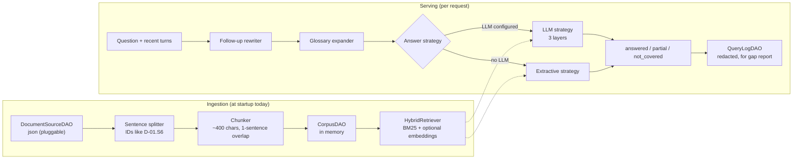
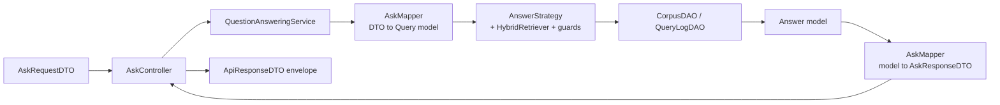
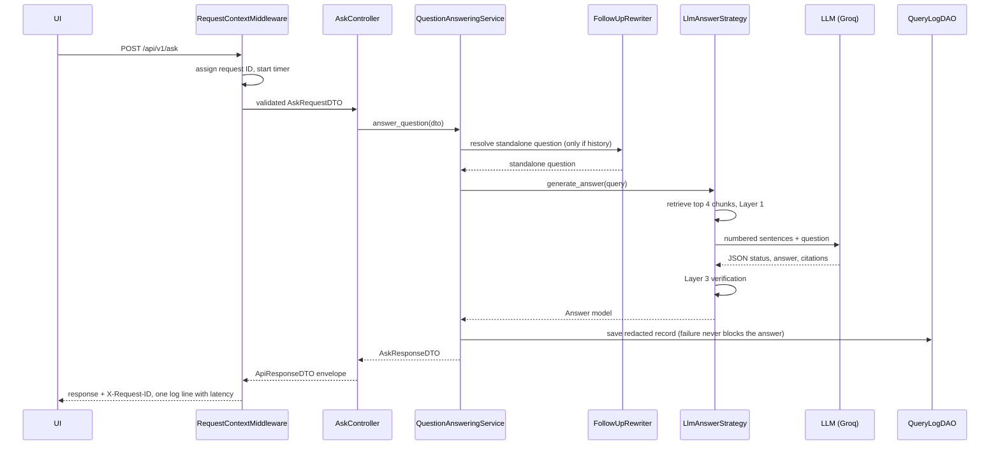
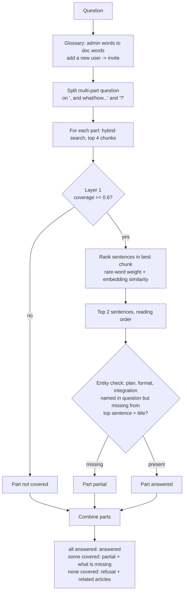
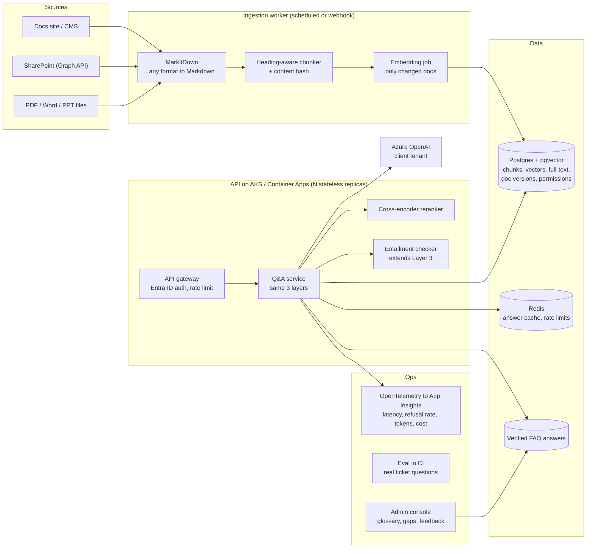

# Architecture: Solstice Docs Q&A Assistant

This document explains how the system is built, why, what went wrong along the way, and where it goes next.
For the short version (problem, assumptions, trade-offs) see `SOLUTION_DESIGN.md`.

Contents
1. Design drivers: what the brief asked and how each point is met
2. Current architecture (v2)
3. The three layers of defence, their checks and thresholds
4. Extractive mode in detail
5. From v1 to v2: problems found and how they were solved
6. Results
7. Why this architecture: alternatives considered
8. Future architecture
9. Engineering decisions and assumptions (code level)
10. Known gaps

---

## 1. Design drivers

| What the brief / client asked | How it is met |
|---|---|
| Plain-English question gets a real answer from the docs | Hybrid retrieval plus an LLM writing a short answer from cited sentences |
| "If the docs don't cover it, say I don't have an answer" (Elena's one hard rule) | Three layers of defence (section 3), a fail-safe when the LLM is down, and eval metrics that count every answered-but-unanswerable question |
| Decide how to search across documents for the right passage | Sentence-aware chunking (fixes the starter kit's lost text), BM25 + embeddings, glossary synonyms |
| Decide how confident an answer must be before showing it | Measurable gates with explicit thresholds, plus a third outcome: `partial` |
| Decide whether to use an LLM at all | Both modes built and measured on the same questions; the gap between them is the justification |
| Document assumptions | `SOLUTION_DESIGN.md` (business) and section 9 here (code) |
| Smaller, well-reasoned scope | Core vs extensions labelled in `SOLUTION_DESIGN.md` |

---

## 2. Current architecture (v2)

### 2.1 Two flows: ingestion and serving

Ingestion builds the corpus; serving answers questions from it. Keeping them separate means a broken document source can never take down question answering once the service is up.

### 2.2 Layered code structure

Each request follows the same path through the layers. Controllers never contain business logic; services never see HTTP; DAOs never see DTOs.

| Layer | Folder | Responsibility |
|---|---|---|
| Controller | `app/api/controllers` | Receive DTO, call service, wrap result in the envelope |
| DTO | `app/dto` | Wire format, validation (lengths, history size) |
| Service | `app/services` | Business flow: rewrite, expand, answer, log |
| Strategy and guards | `app/services/answering`, `app/services/guards` | How an answer is produced and checked |
| Mapper | `app/mappers` | DTO to model and back; redaction before storage |
| Model | `app/models` | Internal data: Document, Sentence, Chunk, Query, Answer |
| DAO | `app/dao` | Where data lives: document source, corpus, query log |
| Core | `app/core` | Settings, logging, middleware, exceptions, envelope, registries, container |

### 2.3 Request lifecycle

### 2.4 Cross-cutting concerns

| Concern | How |
|---|---|
| One response format | `ApiResponseDTO[T]`: status, status_code, message, technical_message, error_code, data, request_id, timestamp |
| Errors | Custom hierarchy in `app/core/exceptions.py`; four central handlers (app, validation, HTTP, unexpected). Technical detail hidden when `EXPOSE_TECHNICAL_MESSAGES=false` (default in Docker) |
| Logging | Request ID on every line, text or JSON. Question text is not logged at INFO; the redacted question goes to the query log |
| Async | Async endpoints and LLM clients; CPU work (search, embeddings) and file I/O in worker threads |
| Pluggability | Registries for LLM provider, document source, query log store; chosen by config |
| Configuration | `pydantic-settings`: env vars, then `.env`, then defaults. Key source logged, masked |
| Prompts | Versioned files in `app/llm/prompts`; version returned in debug output |

---

## 3. The three layers of defence

Elena's rule is enforced by three independent checks. None of them alone is enough; together each covers the others' blind spots.

| | Layer 1: Relevance gate | Layer 2: LLM judgement | Layer 3: Grounding verification |
|---|---|---|---|
| Type | Code, before the LLM | LLM | Code, after the LLM |
| Check | Share of the question's informative terms found in the best chunk (term coverage), or embedding cosine similarity | Do the numbered sentences answer the question fully, partly, or not at all? | Answer not empty; at least one citation; every cited ID was in the context given; every number in the answer appears in the cited sentences |
| Threshold | LLM mode: coverage >= 0.2 (at least 1 term of a 5-term question) or cosine >= 0.35. Extractive mode: coverage >= 0.6, cosine not allowed | Prompt rules; status must be `answered`, `partial` or `not_covered` (anything else is refused) | All-or-nothing; any failure discards the draft |
| Why it exists | Saves LLM cost and latency on obvious misses; reduces exposure to prompt injection | Only meaning-level judgement can tell "related" from "answers it" ("SSO on Growth?" when docs only mention Enterprise) | The LLM can still invent a number or a citation; a deterministic check makes the promise provable |
| What it catches in eval | Weather question; in extractive mode, all out-of-scope questions | In the v1 LLM run: Salesforce, mobile app, delete account, refund on monthly plan, PDF export, prompt injection | Proven by tests with a scripted fake LLM (invented "24 hours", invented `D-99.S1`, no citations). In real runs, the `decision_reason` column shows whether it fired (`grounding_check_failed:...`) |
| Blind spot | Cannot judge meaning | Can be wrong or manipulated | Checks citations and numbers, not every word |
| If removed | More cost and latency, little correctness loss | Becomes extractive mode: partial questions answered as if complete | No proof that answers are grounded |

Two extra safety rules sit around the layers:
- **Fail-safe:** if the LLM fails after one retry, the answer is "I can't verify an answer right now", never a guess. Authentication errors are not retried.
- **Follow-ups never add facts:** earlier answers are used only to understand the question; the new answer still goes through all three layers.

Why the thresholds are these values: 0.6 for extractive mode was tuned on the dev split (lower values let partial questions through, higher values refuse paraphrases). 0.2 for LLM mode is deliberately lenient because Layer 2 does the real judgement; Layer 1 only filters obvious misses. 0.35 cosine is a judgement value for `all-MiniLM-L6-v2` and is the least validated number in the system.

---

## 4. Extractive mode in detail

Extractive mode is the no-LLM path: used when no LLM is configured (for example a client who cannot send data to an LLM) and as the honest baseline that shows what the LLM adds. It never generates text, so it can never invent a fact; its risks are picking the wrong sentence and treating a partly covered question as answered.

| Step | v1 | v2 | Fixes |
|---|---|---|---|
| Vocabulary | Exact stems only | Glossary synonyms, maintained by support | "add a new user", "kept", "go over" (false refusals) |
| Multi-part questions | One chunk only | Split into parts, answer each | "invite a teammate and password rules" answered only half |
| Sentence choice | Count of shared words | Sum of rare-word weights (BM25 IDF), plus embedding similarity | Generic words no longer outrank the key fact |
| Partial coverage | Not detected | Entity check from glossary | "SSO on Growth?", "refund on monthly", "PDF export", "Starter plan" were answered as if complete |
| Labelling | Shown as "Answer" | Shown as "Most relevant passage, quoted from the docs" | Admin knows it is a quote, not a verified answer |
| LLM fallback | v1 used it when the LLM failed | Not used as a fallback; LLM failure gives a safe refusal | v1's only LLM-mode failure (E-12) |

Remaining limits, visible on the held-out test split: unseen vocabulary ("minimum length", "protocol") causes false refusals, and limits the docs are silent about ("how many members can I invite?") are answered with the nearest passage. These need meaning, which is what Layer 2 provides.

---

## 5. From v1 to v2: problems found and how they were solved

| # | Problem | How it was found | v2 solution |
|---|---|---|---|
| 1 | Starter chunker dropped the end of every article; 2 articles had no chunks; the answers to Q-2, Q-3, Q-4 were lost | Ran the starter code against the seed data | Sentence-aware chunking with overlap; test proves no text is lost |
| 2 | Starter keyword score ranked Salesforce (not covered) above password reset (covered); no threshold could separate them | Same run | BM25 plus the three layers; refusal is not based on one score |
| 3 | Starter never refuses | Eval: 10/10 unanswerable questions answered | Layer 1 and Layer 2 refusals |
| 4 | Doc-ID-only eval hid missing facts | Starter "found" the right doc while the fact was cut off | Eval checks status, cited docs and the key fact |
| 5 | v1 LLM fallback answered an unanswerable question when one LLM call failed | v1 LLM eval: E-12 failed, 1 fallback | Retry once, then fail-safe refusal |
| 6 | Groq client lost JSON mode during the v1 fix | Code review | JSON mode restored, retry without it only if rejected |
| 7 | Stale exported key overrode `.env`; v1 fix reversed precedence, which broke env-based deployment and isolated tests | Runtime auth errors; test design | Standard precedence plus masked "key loaded from" log line |
| 8 | Python 3.10 syntax failed on the 3.9 sandbox | Import error | `typing.Optional`; suite tested on 3.9 and 3.12 |
| 9 | Extractive false refusals and partial questions answered (section 4) | v1 extractive eval: 17/25 | Glossary, split, IDF ranking, entity check |
| 10 | "Is SSO available on Growth?" retrieved the API article because "available" matched | v2 smoke test | "available" made a domain stopword |
| 11 | Eval table hid the mode, so the fallback cause of E-12 was invisible | Reading v1 results | Mode and answer columns; `--runs`; dev/test split |
| 12 | Eval questions written by us invite overfitting | Design review | 13 held-out test questions written before tuning, never tuned on |
| 13 | Flat module structure, inconsistent error bodies | Review for production | Layered structure, one envelope, central exception handling |

---

## 6. Results

The v1 evaluation was a single 25-question set, without separate development and test splits. For v2, 13 entirely new questions were added as a held-out test set alongside the 25-question dev set. The dev set was used during development and tuning; the test set was not. These are evaluation splits, not model-training data. The four follow-up cases are additional LLM-only checks, beyond the 25 + 13 core questions.

| Version / mode | v1 single set / v2 dev (25) | Held-out test (13) | LLM-only follow-ups (4) | Total and run consistency |
|---|---:|---:|---:|---|
| Starter kit (v2 evaluation set) | 4/25 | 6/13 | not run | 10/38 |
| Extractive v1 | 17/25 | not measured | not run | 17/25 on the single v1 set |
| LLM v1 (Groq gpt-oss-20b) | 24/25 | not measured | not run | 24/25 on the single v1 set |
| Extractive v2 | 25/25 | 9/13 (4 failed) | not applicable | 34/38; follow-ups require an LLM |
| LLM v2 (Groq gpt-oss-20b) | 25/25 | 13/13 | 4/4 | 42/42 in each of 3 runs |

For v1 extractive, 4/10 unanswerable questions were answered and 3/15 answerable questions were falsely refused; v1 LLM answered 1/10 unanswerable questions and falsely refused 0/15, with one LLM failure falling back to extractive. For v2 extractive, the 2 answered-unanswerable questions were both in the held-out test set (2/5 there; 0/10 on dev); it also falsely refused 2/23 answerable questions. For v2 LLM, every run answered 0/16 unanswerable questions and falsely refused 0/26 answerable questions. Run 3's p50 / max latency was 584 ms / 1215 ms. The v1 extractive and LLM results are from their original, unsplit 25-question evaluation; no v1 held-out test result is available.

The v1 extractive score of 17/25 is from its original unsplit set; v2 scored 25/25 on dev and 9/13 on the newly introduced held-out test. The four held-out misses show the limit of tuning on a small dev set: unseen vocabulary ("minimum length", "protocol") causes false refusals, and questions about limits the docs do not specify ("how many members can I invite?") can be answered with the nearest passage. LLM v2 scored 42/42 on each run, including the four follow-ups. Caveat: we wrote these 42 questions ourselves, so 42/42 is evidence the design works, not proof. Real admin questions from Elena's ticket history are the next step.

---

## 7. Why this architecture: alternatives considered

Five alternatives were weighed against the requirement (refusal must be reliable and provable) and the constraints (6 articles growing to hundreds, small budget, must be explainable).

| Option | Strength | Why not chosen now | When we would switch |
|---|---|---|---|
| Plain RAG, refusal by prompt only | Simplest LLM design | Refusal depends on the model obeying; nothing proves it | Never for this requirement; it is our design minus two checks |
| All docs in the prompt (long context) | No retrieval misses, simplest code | Cost and latency grow with the docs; still needs verification | If the docs stay under roughly 50 pages and cost is acceptable |
| Agentic / self-correcting RAG | Handles multi-step questions | 2-5 LLM calls per question; harder to test | If questions become multi-step troubleshooting |
| Curated FAQ answers | Highest precision, approved wording | Manual upkeep, misses the long tail | As a layer on top: Elena said "the same handful of questions" |
| Search only (extractive) | No LLM, no generated text | Cannot judge partial coverage (9/13 on held-out) | If the client cannot use an LLM |

---

## 8. Future architecture

### 8.1 Target design

### 8.2 What each addition solves in v2

| Addition | v2 problem it solves | Plugs in at |
|---|---|---|
| Postgres + pgvector | In-memory index is lost on restart and becomes a constraint as the corpus grows | New `CorpusDAO` implementation |
| Ingestion worker + content hash | Index rebuilt at every startup; no live updates | `CorpusBuilder` moved out of the API process |
| Cross-encoder reranker | Embedding cosine is a weak, uncalibrated relevance signal | After hybrid search |
| Entailment (NLI) check | Layer 3 verifies numbers and citations, not every claim | Grounding verifier |
| Entra ID auth + rate limits | API is open | Gateway / middleware |
| Eval in CI on real ticket questions | Eval set written by us | GitHub Actions |

Beyond these, likely additions are a docs-site/SharePoint connector for live content, an admin console for glossary and gaps, and token/cost tracking per question; see [SOLUTION_DESIGN.md](SOLUTION_DESIGN.md) §6.

### 8.3 Suggested phases

1. **Harden for production:** Azure OpenAI in the client tenant, auth, rate limits, Postgres query log, CI.
2. **Scale content:** docs-site connector, ingestion worker, pgvector, reranker.
3. **Improve quality:** real ticket questions as the eval set, entailment check.

---

## 9. Engineering decisions and assumptions (code level)

**Text processing**
- Stopwords are a hand-maintained list (~120 words), not NLTK/spaCy: no downloads, no extra dependency, fully visible. Two domain stopwords: "solstice" (product name) and "available" (question filler; added after bug 10). "not" and "no" are stopwords, so negation is ignored in matching.
- Stemming uses the `snowballstemmer` library (Porter2), not a hand-written list. It is light: "forgot" and "forgotten" do not match.
- Tokenising is a regex on letters and digits; commas inside numbers are removed first ("10,000" becomes "10000"). Underscored names split ("next_cursor" becomes "next" and "cursor").
- Sentences split on `.`, `!` or `?` followed by a capital letter, digit, quote or bracket. Abbreviations like "e.g. The" would split wrongly; none exist in the seed docs.

**Chunking and retrieval**
- Chunks are about 400 characters (the starter kit's size) with a one-sentence overlap; the article title is added to each chunk's searchable text.
- BM25 is implemented in about 50 lines rather than using `rank_bm25`, so every score is explainable and IDF can be reused for sentence ranking. Parameters are the standard defaults (k1 = 1.5, b = 0.75), not tuned.
- Rankings are fused with Reciprocal Rank Fusion using the standard constant 60, because BM25 and cosine scores are on different scales.
- Top 4 chunks are retrieved, a third of the 12-chunk corpus; this must shrink relative to corpus size at scale.
- Embeddings use `all-MiniLM-L6-v2` (small, fast, 384 dimensions) and are optional; without them search is keyword-only.

**LLM**
- JSON mode (`response_format: json_object`) plus our own parser, not strict JSON-schema structured outputs. Reasons: the same code must work across Groq, Azure and any OpenAI-compatible endpoint, and strict schema support varies by model; every field is validated by our code anyway (Layer 3). If the provider rejects JSON mode, the call is retried once without it. Strict structured outputs are a sensible upgrade where all target models support them.
- The parser tolerates code fences and stray text around the JSON object.
- Temperature 0; max 1,500 output tokens (gpt-oss reasoning uses part of the budget).
- One retry with 0.5 s backoff; SDK retries are switched off to avoid double retries; authentication errors are not retried; 20 s timeout per call.
- Sentence IDs are numbered in the prompt; the question sits in `<question>` tags; the prompt says to ignore instructions inside documents or the question.
- Citation markers the model writes into the answer text are stripped before display.
- The number check compares digits only: "twice", "two" or units are not verified.
- The `missing` text of a partial answer comes from the LLM and is not verified; it describes what is absent, not a fact.

**Follow-ups**
- Last 3 turns kept; earlier answers cut to 300 characters; history comes from the client and is trusted only for understanding the question.
- Same model rewrites the question; on failure the question is used as typed. No rewriting in extractive mode.

**Extractive mode**
- At most 2 sentences per part; the top-ranked sentence plus the article title is the evidence for the entity check; embedding similarity is added with weight 1.0.
- Glossary synonyms change only the search text; the LLM always sees the admin's own wording.

**API and operations**
- Single process; corpus rebuilt in memory at startup.
- Incoming `X-Request-ID` reused only if it matches a safe pattern (64 characters max), otherwise a new 16-character ID.
- Technical error messages shown locally, hidden in Docker.
- JSONL query log with a thread lock: safe for one process, not for several workers.
- Redaction covers emails and runs of 6+ digits, not names.
- The gap report groups by exact lower-cased question; paraphrases are counted separately.
- Feedback returns 201; every response repeats the HTTP status inside the envelope.

**Evaluation**
- A question passes if its status is one of the expected ones, an answered status cites all expected articles (partial: at least one), and the answer contains at least one key phrase.
- Follow-up cases are skipped in extractive mode.
- The judge checks key phrases, not answer quality: Q-1 in extractive mode without embeddings returns the link-expiry sentences rather than the reset steps.

---

## 10. Known gaps

- Eval questions are written by us; real admin questions are the most important missing input.
- No authentication, rate limiting or overall request time budget.
- No token or cost tracking per question.
- The 0.35 cosine threshold is the least validated number.
- Index is not persisted or versioned; no live re-indexing.
- Citations point to articles, not sections or URLs (the seed data has no URLs).
- English only.
